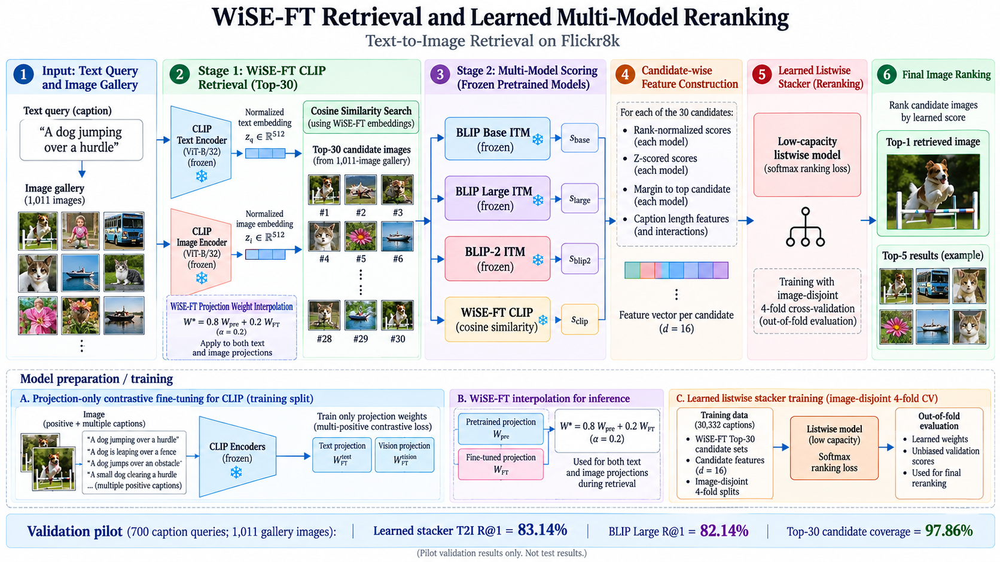

# fine-grained-text-to-image-retrieval
A two-stage text-to-image retrieval system combining WiSE-FT CLIP, pretrained vision-language rerankers, and learned listwise ranking.

**A two-stage vision-language retrieval system combining WiSE-FT CLIP, frozen BLIP-family rerankers, and a learned listwise ranker.**

Built with PyTorch and Hugging Face Transformers, and evaluated on the Flickr8k dataset using Kaggle GPUs.

## 1. Project Overview

Text-to-image retrieval aims to identify the most relevant image from a gallery using a natural-language description.

Although pretrained vision-language models such as CLIP achieve strong image–text alignment, they can struggle with fine-grained distinctions involving objects, actions, relationships, and visually similar scenes.

In this project, we investigate these limitations and develop a two-stage retrieval pipeline that combines efficient candidate retrieval with more detailed cross-modal matching.

### Key Challenges

- **Fine-tuning degradation:** Standard projection-layer fine-tuning reduced CLIP retrieval performance in our initial experiments.
- **Fine-grained matching:** Correct images sometimes appeared in the Top-K candidates but were ranked below visually similar alternatives.
- **Short captions:** Brief or generic descriptions often provide insufficient information to distinguish between multiple plausible images.

## 2. Proposed Pipeline

Our final system consists of three main stages.

### Stage 1: WiSE-FT CLIP Candidate Retrieval

We use pretrained CLIP ViT-B/32 as the backbone.

Both the image and text encoders remain frozen, while their projection layers are fine-tuned using a multi-positive contrastive objective.

To reduce the degradation observed during fine-tuning, we apply WiSE-FT weight interpolation:

**W = (1 − α)W_pretrained + αW_finetuned**

We use α = 0.2, selected through earlier validation experiments.

The resulting model retrieves the **Top-30 candidate images** using cosine similarity.

### Stage 2: Multi-Model Image–Text Matching

Each candidate image is evaluated using four complementary scoring sources:

| Scorer | Purpose |
|---|---|
| WiSE-FT CLIP | Global image–text cosine similarity |
| BLIP Base ITM | Cross-modal image–text matching |
| BLIP Large ITM | Larger pretrained matching model |
| BLIP-2 ITM | Q-Former-based image–text matching |

The pretrained BLIP-family models remain frozen.

### Stage 3: Learned Listwise Reranking

Instead of using manually selected fusion weights, we construct a 16-dimensional feature representation for each candidate.

The features include:

- Z-normalized matching scores
- Rank-normalized scores
- Margins relative to the highest-scoring candidate
- Interactions between scores and caption length

A lightweight listwise model learns how to combine these features and rank the candidate images.

We use **image-disjoint 4-fold cross-validation** to produce out-of-fold validation predictions.

## 3. Experimental Results

### Latest Validation Pilot

Evaluation setting: 700 caption queries, 1,011 gallery images, Top-30 candidate retrieval.

| Method | Recall@1 | Recall@5 | Recall@10 |
|---|---:|---:|---:|
| WiSE-FT CLIP | 55.00% | 82.86% | 91.00% |
| BLIP Base | 80.14% | 95.14% | 97.29% |
| BLIP Large | 82.14% | 96.71% | 97.57% |
| BLIP-2 ITM | 82.57% | 96.00% | 97.43% |
| **Learned Listwise Stacker** | **83.14%** | 96.43% | **97.71%** |

**Top-30 candidate coverage: 97.86%.**

The learned stacker achieved the highest Recall@1 in this pilot, improving by 1.00 percentage point over BLIP Large.

However, the improvement is relatively small, and additional evaluation is needed to establish its statistical reliability.

### Caption-Length Analysis

| Caption Length | BLIP Large R@1 | Learned Stacker R@1 |
|---|---:|---:|
| Short (1–7 words) | 67.14% | **71.43%** |
| Medium (8–13 words) | 81.55% | **82.69%** |
| Long (14+ words) | **89.01%** | 88.48% |

The learned stacker showed encouraging performance on short captions, although it did not improve every caption-length category.

**Evaluation note:** These results come from a validation pilot with out-of-fold stacker predictions. They are not full-validation or independent-test results for the final learned-stacker pipeline.

## 4. Dataset

We use the Flickr8k dataset, containing approximately 8,000 images with five natural-language captions per image.

Dataset: https://www.kaggle.com/datasets/adityajn105/flickr8k

The notebook uses a reproducible image-level train/validation/test split, ensuring that an image and its captions remain in the same partition.

## 5. Implementation

**Technologies:** Python, PyTorch, Hugging Face Transformers, NumPy, pandas, scikit-learn, Pillow and Matplotlib.

**Execution Environment:** Kaggle Notebook with GPU acceleration.

### Reproduce the Project

1. Open `notebooks/final_retrieval_pipeline.ipynb` in Kaggle.
2. Add the Flickr8k dataset as an input.
3. Enable GPU acceleration and Internet access for downloading pretrained checkpoints.
4. Run the notebook cells in order.
5. Inspect the generated retrieval metrics, confidence intervals, and qualitative examples.

For a smaller initial experiment, configure `PILOT_IMAGE_COUNT = 140` and `RUN_FINAL_TEST = False`.

For full validation, set `PILOT_IMAGE_COUNT = None`.

The notebook saves its outputs under `/kaggle/working/final_wise_blip_stacker/`.

## 6. Limitations

- Short captions can match multiple valid images, while standard evaluation usually assigns only one ground-truth image to each caption query.
- The newest learned-stacker pipeline has not yet been independently confirmed on a completely untouched test set.
- Earlier project experiments inspected the test split, limiting claims of fully independent evaluation.
- Potential overlap between the evaluation dataset and some pretrained models' upstream training data has not been conclusively excluded.
- The system combines established techniques and does not claim a novel architecture or state-of-the-art performance.

## 7. References

1. Radford et al., [Learning Transferable Visual Models From Natural Language Supervision](https://arxiv.org/abs/2103.00020), ICML 2021.
2. Wortsman et al., [Robust Fine-Tuning of Zero-Shot Models](https://openaccess.thecvf.com/content/CVPR2022/html/Wortsman_Robust_Fine-Tuning_of_Zero-Shot_Models_CVPR_2022_paper.html), CVPR 2022.
3. Li et al., [BLIP: Bootstrapping Language-Image Pre-training for Unified Vision-Language Understanding and Generation](https://proceedings.mlr.press/v162/li22n.html), ICML 2022.
4. Li et al., [BLIP-2: Bootstrapping Language-Image Pre-training with Frozen Image Encoders and Large Language Models](https://proceedings.mlr.press/v202/li23q.html), ICML 2023.

## 8. Project Status

This project is a reproducible experimental implementation of a multi-stage text-to-image retrieval system, developed through iterative failure analysis, baseline comparison, and controlled ablation studies.

Its primary contribution is the empirical investigation and integration of pretrained retrieval and reranking methods.
